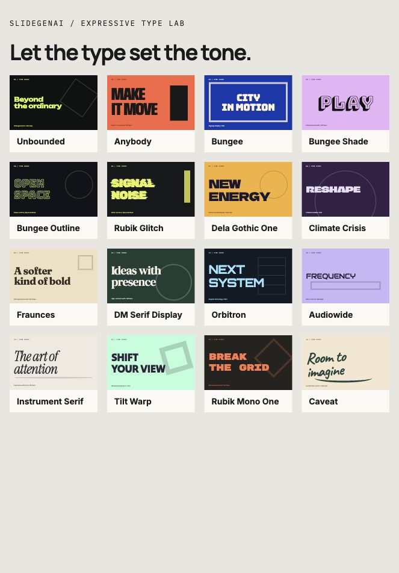
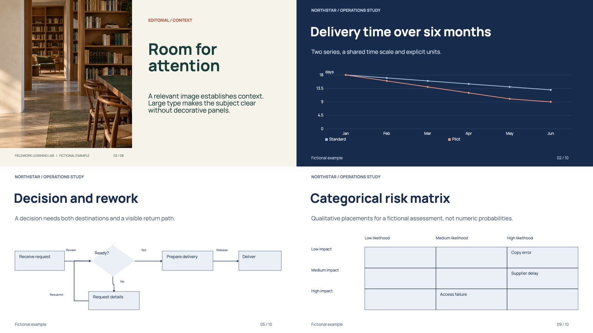
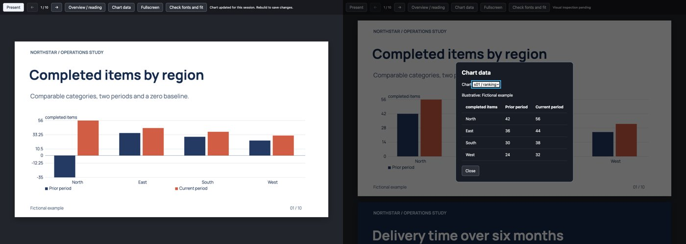

# SlideGenAI Skill

**Create a complete presentation from a topic, outline or reference—with an original visual direction or your brand identity.**

The workflow adapts to your purpose, audience, content, visual constraints, output format and available tools; no website or fixed template is required.

SlideGenAI Skill gives your AI assistant a reusable workflow for creating and editing presentations: typography, images, topic covers, varied layouts, editable charts, tables and diagrams. You provide a topic or content, and optionally a visual reference; the assistant uses the tools available in your session to build and review the result.

The skill you install is called **`slidegenai`**. Start your request with **`/slidegenai`**. You do not need to install the SlideGenAI application. This repository supplies instructions, resources, examples and an optional executable visual kit; your assistant supplies browsing, slide creation, image generation and rendering when those tools are available.

**Start here:** [Install](#1-install-the-skill) → [Create your first deck](#2-create-your-first-presentation) → [Improve the result](#3-refine-without-starting-over).

## Preview: styles and capabilities

Real rendered slides from fictional studies made with the skill. Choose a direction that fits your subject, or provide your own brand reference.


### Beyond the cover

Topic covers, full-page photography, contrasting typography, editable charts, tables, flows and schedules:


[Download the eight-slide PowerPoint example](examples/portable-deck/example.pptx) · [View its PDF](examples/portable-deck/example.pdf) · [Explore the analytical example](examples/analytical-patterns/README.md).

These previews demonstrate completed studies. The catalog contains **177 style directions**, rather than 177 downloadable PowerPoint masters. All entries share the construction workflow; a complete deck has not been visually tested for every entry.

## One entry point: `/slidegenai`

```text
/slidegenai Create an 8-slide presentation about [topic].
Audience: [audience]. Language: [language].
Use varied layouts, meaningful imagery and editable evidence where appropriate.
Deliver the requested format and inspect the final output.
```

Claude Code and Antigravity can expose this as a native slash command after installation. Other interfaces have their own skill selectors: Codex CLI/IDE uses `$slidegenai` or `/skills`; ChatGPT uses `@` selection when available. Select the skill first if needed, then use the same request. If a host rejects an unknown slash command before sending the message, write **“Use /slidegenai: [brief]”** as plain text with the skill loaded. This prefix cannot install resources or override an application's command parser. [Host details](slidegenai/references/invocation.md).

**Upgrading from brand-presentations:** version 2 uses the installable folder/name **slidegenai** and new ZIP names. Back up the previous complete folder, install the complete slidegenai folder, disable the old discovery entry and restart the host. Keep custom brand assets and accepted decks. Do not keep two active copies or overlay folders from different releases. Historical test records retain the old name; they do not certify native activation under the new name.

## 1. Install the skill

**Claude.ai upload limit:** choose the **Claude.ai profile** ZIP. The complete/full ZIP contains more font faces and exceeds the 30 MB uncompressed limit observed in Claude.ai. A ZIP's download size is not its extracted size. Package reports now include `uncompressed_bytes`.

**Ready-made downloads:** [Claude.ai profile](https://github.com/Everton-baptista/skill-slidegenai/releases/download/v2.3.2/slidegenai-claude-ai-2.3.2.zip) · [Complete skill folder ZIP](https://github.com/Everton-baptista/skill-slidegenai/releases/download/v2.3.2/slidegenai-full-2.3.2.zip). Extract the complete ZIP before copying its slidegenai folder for local agents.

Choose **one** installation method for the assistant you use. Install the entire `slidegenai/` folder, including its references, scripts, assets and licenses. Copying only `SKILL.md` leaves resources missing.

### Download the repository

In a terminal:

```sh
git clone https://github.com/Everton-baptista/skill-slidegenai.git
cd skill-slidegenai
```

Without Git, use **Code → Download ZIP** on GitHub and extract it. Open a terminal in the extracted repository folder before running the commands below.

### Claude.ai — upload and enable the ZIP

**[Download the ready-to-install Claude.ai ZIP (v2.3.2)](https://github.com/Everton-baptista/skill-slidegenai/releases/download/v2.3.2/slidegenai-claude-ai-2.3.2.zip).** No local Python is needed when using this download. [Release notes and SHA-256 checksums](https://github.com/Everton-baptista/skill-slidegenai/releases/tag/v2.3.2). This is a preview release: the previous 1.1.3 installation was verified; the new kit’s full two-host authoring evaluation is incomplete.

To build it yourself from the downloaded repository folder, with Python 3.9+:

```sh
python3 -B slidegenai/scripts/package_skill.py --profile claude-ai --output dist/slidegenai-claude-ai.zip
```

Upload the downloaded ZIP (or your locally built **dist/slidegenai-claude-ai.zip**) in **Customize → Skills → + → Create skill → Upload a skill**, then enable **slidegenai**. Skills require code execution/file creation and any applicable organization permissions. Start a new conversation, select the enabled skill when the interface offers it, and begin your request with **`/slidegenai`**. Ask Claude to identify the installed VERSION and the resources it actually loaded. [Official Claude.ai instructions](https://support.claude.com/en/articles/12512180-use-skills-in-claude).

The Claude.ai ZIP contains one installable folder with every reference/helper, all 46 font families and their original licenses. It selects a smaller set of original faces/weights, with exact inventory in DISTRIBUTION.json and the font manifest. The complete 140-font bundle was rejected by the tested Claude.ai interface because its uncompressed size exceeded 30 MB. The size-limited profile is kept below 29 MB uncompressed and uses portable filenames, with original paths recorded; no font binaries or internal font identities are modified. The packager validates resources before writing and refuses to overwrite an existing ZIP; use a new output filename for another build. The GitHub **Download ZIP** is the repository archive, not this installable package. Reading a repository link or uploading it as chat context does not prove native skill activation.

**Update:** back up any custom changes, open the skill’s more-options menu → **Replace**, upload the new complete profile ZIP, confirm it remains enabled and start a fresh conversation. Confirm its VERSION; avoid mixed releases. The 30 MB uncompressed limit was observed in the tested Claude.ai interface; other hosts/accounts may differ.

Native Slides and terminal/file authoring are different paths. If native Slides cannot be visually inspected, the skill directs Claude to produce and inspect an editable PPTX in that Claude session when supported; the native version retains its separate verification status. See [Claude.ai operations](slidegenai/references/claude-ai.md).

### Codex — macOS / Linux

Run from the downloaded repository folder:

```sh
mkdir -p "$HOME/.agents/skills"
# Stop if an installed copy already exists; see Updating below.
test ! -e "$HOME/.agents/skills/slidegenai" && \
  cp -R slidegenai "$HOME/.agents/skills/slidegenai"
```

Open a new Codex session, select the skill with **`$slidegenai`** or **`/skills`**, and use the shared **`/slidegenai`** request prefix. For a project-only installation, copy the folder to `<your-project>/.agents/skills/slidegenai` instead. [Official Codex installation locations](https://learn.chatgpt.com/docs/build-skills).

### Claude Code — macOS / Linux

Run from the downloaded repository folder:

```sh
mkdir -p "$HOME/.claude/skills"
# Stop if an installed copy already exists; see Updating below.
test ! -e "$HOME/.claude/skills/slidegenai" && \
  cp -R slidegenai "$HOME/.claude/skills/slidegenai"
```

Start a Claude Code session and invoke **`/slidegenai`**. For project scope, use `<your-project>/.claude/skills/slidegenai`. These local paths apply to Claude Code; cloud and Cowork sessions use different discovery mechanisms. [Official Claude Code skill instructions](https://code.claude.com/docs/en/skills).

### Antigravity — macOS / Linux

From the downloaded repository folder, install for one workspace:

```sh
mkdir -p /path/to/your-project/.agents/skills
# Replace /path/to/your-project; stop if the destination already exists.
test ! -e /path/to/your-project/.agents/skills/slidegenai && \
  cp -R slidegenai /path/to/your-project/.agents/skills/slidegenai
```

For all workspaces, use `$HOME/.gemini/config/skills/slidegenai` instead. Use **`/slidegenai`** in a new conversation and confirm the loaded VERSION. The current workspace path is `.agents/skills`; `.agent/skills` is the legacy compatible path. [Official Antigravity documentation](https://antigravity.google/docs/skills?app=antigravity-ide). Installation instructions are documented; end-to-end Antigravity slide creation remains untested.

### ChatGPT and GPT-based applications

In eligible ChatGPT workspaces, open **Plugins → Skills → Create → Upload from your computer**, follow the accepted file format shown by the interface, and confirm the uploaded skill is available after scanning. Availability depends on account/workspace settings. Do not assume a local Codex installation appears automatically in ChatGPT. [Official ChatGPT skills guidance](https://help.openai.com/en/articles/20001066-skills-in-chatgpt/).

If the interface has no native Skills import, use the context-only instructions below. A Custom GPT instruction field, a GPT model selected in another app and a native installed skill are different integrations. No ChatGPT or API end-to-end compatibility is claimed from format compliance alone. See [host integration](slidegenai/references/host-integration.md).

### Windows — PowerShell

Run from the downloaded repository folder. The example installs for Codex; replace `.agents/skills` with `.claude/skills` for Claude Code.

```powershell
$skillsRoot = Join-Path $HOME '.agents/skills'
$destination = Join-Path $skillsRoot 'slidegenai'
if (Test-Path $destination) { throw 'Back up the existing skill before installing.' }
New-Item -ItemType Directory -Force -Path $skillsRoot | Out-Null
Copy-Item -Recurse -Path './slidegenai' -Destination $destination
```

Then start a new assistant session and use the invocation shown above for your host.

### Other chat interfaces or context-only use

If your interface supports importing skill folders, follow its import instructions. Otherwise, make `slidegenai/SKILL.md` and the relevant `references/` files available as task context. If it cannot follow file links, attach or paste the referenced instructions needed for your task.

Start your request with **`/slidegenai`** and provide the reference material. A chat interface that can only return text can produce a storyboard; creating a PPTX requires file-authoring tools. Uploading the repository does not automatically activate a native skill.

### Check the installation — optional

Python is **not required to read or use the instructions**. With Python 3.9+, check the downloaded bundle from the repository root:

```sh
python3 -B slidegenai/scripts/check_installation.py
```

To check the actual installed copy, open its `slidegenai` folder and run:

```sh
python3 -B scripts/check_installation.py
```

On Windows, replace `python3 -B` with `py -3 -B`. A successful check confirms that resources, links, template entries and font files are present and valid. It does not test your assistant's slide-creation tools.

**Updating:** back up or rename the old installed `slidegenai` folder, download the latest repository and copy the complete new folder. Avoid merging different versions. Restart discovery if the skill does not appear. [Troubleshooting](docs/TROUBLESHOOTING.md).

## 2. Create your first presentation

Describe the following when available. A visual reference is optional; a topic is enough to start an original presentation. You can write in any language; the slides follow the language you request.

| Input | Example |
| --- | --- |
| Visual reference (optional) | Website URL, brand guide, PPTX, PDF or screenshots; omit for original art direction |
| Topic and content | Product launch, supplied outline, report or notes |
| Audience and purpose | Leadership team; explain a proposal and secure a decision |
| Slide count | 12 slides, including cover, topic covers and closing |
| Output language | Brazilian Portuguese |
| Output format | Editable PPTX and preview, if supported by the host |

If you only have a topic, the assistant can develop an outline and original art direction. Provide real data for factual charts; request clearly labeled illustrative data for fictional demonstrations.

### Start with a topic only

```text
/slidegenai

Create an 8-slide presentation about circular economy for small businesses.
Audience: business owners. Language: Brazilian Portuguese.
There is no brand or visual reference: choose an original visual direction.
Include topic covers where useful, varied layouts, strong typography and
an editable process diagram. Do not invent company metrics.
Use your available slide editor to create the complete editable deck and
preview. Render and inspect it if supported; disclose any tool limitations.
```

No screenshot, website, brand guide or Python script is required for this route. The skill guides creation; the host still needs authoring tools to produce a slide file.

### Create from a visual reference

Use the same `/slidegenai` request prefix. Activate the skill through the host’s native selector when required; see [invocation by host](slidegenai/references/invocation.md).

```text
/slidegenai

Create a 12-slide presentation about [TOPIC] for [AUDIENCE].
Visual reference: [WEBSITE URL or attached files].
Content: [PASTE YOUR OUTLINE or identify the attached document].
Language: Brazilian Portuguese.
Deliver an editable PPTX and a preview if your tools support them.

Adapt the brand creatively while preserving its identity and original logo.
Include topic covers within the 12-slide total, varied content layouts,
large typography and relevant images. Use full-page photography with a
reading gradient where it helps. Choose fonts that fit the subject.
Build charts, tables and diagrams as editable objects where supported.
Use only supplied or verified facts; label illustrative data clearly.
Render and inspect the final slides and the exported file if possible.
Tell me what you actually created, checked and could not verify.
```

Replace the bracketed fields before sending. Attach any files mentioned in the prompt. For website work, the assistant should inspect its available browser, raw-HTTP, download and editor-import capabilities before asking you to supply files. A text-only reader cannot establish exact CSS or typography, but a separate supported fetch/download path may still retrieve original assets. If essential evidence remains inaccessible, it should request that specific material and continue independent work.

**Want to reproduce a template closely?** Replace “Adapt the brand creatively” with “Reproduce the attached template faithfully; import or clone it when supported and preserve its masters, dimensions, fonts and layout rules.”

### What you should receive

With suitable authoring tools: a presentation in the supported format, a visual preview when rendering is available, and a short account of checks and limitations. Without those tools: a clearly identified storyboard or unverified draft. A JSON plan alone is not a finished deck.

You do not need to write JSON, run validators or choose layouts manually for normal use. Those resources help the assistant carry out the work.

## 3. Refine without starting over

Keep working in the same conversation and identify the slides to change. Examples:

```text
Keep the approved slides. On slides 4 and 7, replace the card grids with
an editorial image layout and a clear comparison. Preserve the facts.
Use a full-page image on slide 4, with editable text over a reading gradient.
Render and check the affected slides again.
```

```text
Add a decision flow with Yes/No branches and a rework path on slide 6.
Keep its nodes, labels and connectors editable where supported.
Use the attached process steps; do not invent additional decisions.
```

```text
The headings feel generic. Choose a stronger display font from the bundled
pack and pair it with a readable body font. Keep the brand's tone.
Check accents, line breaks and overflow after loading the fonts.
```

## More ways to use it

Use your host's invocation prefix with these requests.

| Goal | Request to copy and adapt |
| --- | --- |
| Choose a catalog style | “Create an 8-slide fictional deck about urban mobility using Neo Tokyo from the catalog. Include a topic cover, editable comparison chart and process diagram.” |
| Extract a brand first | “Analyze this website and brand guide. Deliver an evidence-backed brand profile, asset inventory and gaps. Do not create slides yet.” |
| Edit an existing deck | “Update slides 3 and 5 using the attached content. Preserve the original masters, dimensions, notes, typography and native charts/tables. Compare before and after.” |
| Create a reusable brand skill | “Create an acme-presentations skill from these references, with permitted assets, identity rules, measured layouts and a usage example. Validate and package it; report what was checked.” |

Browse the [177 style directions](slidegenai/references/template-catalog.md), including Acid Rave, Cyberpunk, NOVA, Ultimate Luxury, Bauhaus and Kinetic. A chosen direction guides composition throughout the deck; supplied brand rules take priority. [How styles adapt](slidegenai/references/all-template-construction.md).

## Fonts and images

**Fonts are included:** 46 openly licensed families / 140 original TTF files, about 54.1 MB. Copying the complete skill brings them with it. The size-limited Claude.ai ZIP retains all families with selected faces/weights; consult its included manifest. The authoring tool still needs to load or register the selected fonts; bundling does not automatically install them on your operating system or embed them in a PPTX. Ask the assistant to use the local pack and recheck text fit after substitutions. [Font setup and licenses](slidegenai/references/font-pack.md) · [Local font specimen](slidegenai/assets/fonts/specimen.html).

**Want more expressive titles?** The pack now includes wide geometric, condensed, outline, shaded, glitch, sculptural, editorial and handwritten choices. Explore the [16-family type lab](slidegenai/assets/fonts/expressive.html) and [when to use each family](slidegenai/references/expressive-typography.md). Download the repository and open the lab through a local HTTP server to see the live fonts; GitHub shows HTML source.



**Website images can be collected locally:** with Python and permitted network access, the optional [asset collector](slidegenai/scripts/collect_website_assets.py) saves selected public images and decodes embedded SVG logos. The assistant must then inspect and import those files through the slide editor. [Commands and limits](slidegenai/references/website-assets.md). Local-file-only import does not automatically mean you must download and upload everything manually.

**Images come from your assets or the host's available tools.** The skill includes no image-generation service. Availability, cost, licenses and watermarks depend on the provider or source. Preserve original logos and use assets you have permission to use.

## Try an example without an AI provider

To see a completed result immediately, open the checked-in [PowerPoint](examples/portable-deck/example.pptx) or [PDF](examples/portable-deck/example.pdf).

To reproduce the eight-slide example locally, install **Node.js 20+** and run from the repository root. HTML generation needs no npm dependencies or API key:

```sh
cd examples/portable-deck
node build.mjs --format html --out ./generated-html
```

Open `generated-html/preview.html` in a browser. For the optional editable PPTX build:

```sh
npm ci --ignore-scripts
node build.mjs --format all --out ./generated
```

The initial npm install needs network access or a populated cache. Use a new output directory on subsequent runs. This builder reproduces the included example; it is not a general renderer for arbitrary template requests. [Full reproduction, rendering and checking instructions](examples/portable-deck/README.md).

## Common questions

**Do I need an API key or a paid subscription?** The instructions, local fonts and Python helpers require no provider key. Your assistant's authoring, browsing or image tools may require an account, subscription or payment. The optional example adapter uses local Node.js dependencies.

**Is this only an identity-extraction skill?** No. It creates complete presentations from topics, outlines and data, edits decks, extracts identity when requested, and can package reusable brand skills. References are optional for original work. Using the host's slide editor is expected; running the Python helpers is optional.

**Can I use my own brand instead of a catalog style?** Yes. Supply its website, guide or deck. Ask for either a faithful reproduction or a creative adaptation. Missing references and inferred rules should be reported honestly.

**Does it work with every AI assistant?** The instructions are portable, but discovery, file creation and export support vary. Claude end-to-end validation remains incomplete; see the per-environment results below.

**Why did I receive text instead of a PowerPoint?** The session may lack file-authoring tools. Ask the assistant what it can create, then use a capable host or request a storyboard. The skill cannot add missing tools to a chat interface.

**Why is the result different after export?** Fonts, gradients, crops or native objects may change between tools. Review the actual exported file and request focused repairs. [Export and installation troubleshooting](docs/TROUBLESHOOTING.md).

## Optional visual kit: HTML/CSS/SVG and editable PPTX



Ask your assistant: **“/slidegenai Use the visual kit when appropriate. Build the presentation with images, expressive typography and layouts that fit the content; render and inspect the actual deliverable.”** The assistant can still use its native editor.

The 2.3 visual correction connects catalog directions to authored composition, semantic color and analytical-object treatment through opt-in `catalog_treatment`. All 177 IDs resolve through the shared factory; explicit brand/design choices win. It also bundles nine executable visual reference pairs with optimized original concept artwork, live expressive type and structured charts/tables. These reproduce existing studies and provide a visible design standard. They are not nine exclusive styles or a certification of 177 source masters. [Reference usage](slidegenai/references/visual-reference-library.md) · [Catalog treatment and limits](slidegenai/references/visual-kit.md#catalog-character-and-composition).

The kit supplies working covers, topic covers, editorial layouts, full-page image/gradient compositions, typographic statements, comparisons and closing slides. It also builds four chart types, tables, processes, decision flows, swimlanes, system relationships, roadmaps and matrices from data. Effects and layout recipes are optional; the content controls their selection.

The 2.1 update adds alternate geometry: image-right covers/topic covers/closings, inset editorial images, bottom-gradient photo captions, offset statements and open-column comparisons. The assistant chooses these by content or authors custom layouts. The entry instructions are shorter, with concrete art-direction and repair guidance in task-specific references. These changes broaden construction options; they do not certify beauty or completion in an untested host. [Composition choices and usage](slidegenai/references/visual-kit.md).

The 2.2 HTML player adds **Present**, keyboard navigation, explicit fullscreen, chart value tooltips, keyboard/click series emphasis and a chart-data table. A local JavaScript API validates new chart models and redraws their axes and marks without a rebuild. Such updates are temporary browser-session changes; they do not create a live-data feed or update saved files. Printing includes all slides and all series. PPTX retains native editable objects and does not inherit browser controls. [Interaction API and format limits](slidegenai/references/visual-kit.md#functional-html-presentations-22).



To reproduce the existing eight-slide source as a self-contained HTML file, install Node.js 20+ and run from the repository folder:

```sh
node slidegenai/assets/visual-kit/build.mjs \
  --plan examples/portable-deck/deck-plan.json \
  --design examples/portable-deck/design-system.json \
  --format html --out output/portable-html
```

Open **output/portable-html/presentation.html**. Select **Overview / reading** to review the deck and **Check fonts and fit** for measurements. No npm installation, CDN, network or paid API is needed for HTML. A new output directory is required for every build.

For PPTX, install the pinned optional dependencies in your local installed copy of the skill using `npm ci --ignore-scripts` inside assets/visual-kit, then use `--format pptx` and a new output directory. Keep the repository used for packaging free of node_modules. Text, tables, charts and diagram parts remain native objects. CSS and PowerPoint have different capabilities; font weights, crop and some effects require inspection and may differ. The kit does not acquire photos or certify its own visual quality.

[Commands, data fields, supported effects and format differences](slidegenai/references/visual-kit.md). Original example-specific builders remain available; their output may differ from the adaptive kit.

## What has actually been tested?

| Area | Recorded evidence and boundary |
| --- | --- |
| Codex desktop on macOS | Creation and visual inspection of fictional decks; evaluated for those artifacts |
| Eight-slide portable example | Native text, table, chart/workbook and process objects checked; PPTX rendered and all slides inspected |
| Ten-slide analytical example | Four native charts, table, diagrams, roadmap and matrix checked; checked-in deck rendered and inspected. The reproduction adapter uses free line segments that need rerouting after nodes move |
| Nine-style study | 54 final slides and nine overviews inspected, with chart, table, connector and typography checks |
| Python helpers and ZIPs | 158 tests, including independently extracted ZIP execution. The renamed v2 source passed [all six CI jobs](https://github.com/Everton-baptista/skill-slidegenai/actions/runs/39258624605), covering Linux/Windows, native objects and offline browser regressions. The previous 157-test release passed Linux/Windows with Python 3.9/3.13; [historical CI run](https://github.com/Everton-baptista/skill-slidegenai/actions/runs/39193657101) |
| Adaptive visual kit (v2 public name: slidegenai) | 23 JavaScript behavior tests including native object checks; both existing studies reproduced in HTML/PPTX, browser fonts and offline loading checked, all pages/overviews inspected. See [kit validation](docs/VISUAL_KIT_VALIDATION.md) for differences and host limits |
| Bundled fonts | All 140 files parsed and integrity checked; browser specimen checks are recorded in the validation guide. OS registration and all native exporters remain host-specific |
| Catalog | All 177 entries resolve structurally; full decks have not been rendered and inspected for every entry |
| PowerPoint, Google Slides, Keynote | Native opening/editing not tested |
| Claude.ai | Legacy brand-presentations 1.1.3 installed and enabled; renamed slidegenai package not installed in that account yet. Real eight-slide and one-slide PPTX outputs from 1.1.2 inspected. Full evaluation incomplete: quota blocked other runs and follow-up corrections. See the per-case record. |
| Claude Code 2.1.252 | CLI available; authentication blocked the six authoring cases. No deck certified. |
| Antigravity | Official discovery paths documented; end-to-end authoring not tested |
| ChatGPT / GPT API applications / Gemini chat / other hosts | Integration depends on host; end-to-end use not tested |

Structural validation does not prove visual quality or factual accuracy. Final rendering and inspection remain part of the workflow. [Detailed validation](docs/VALIDATION.md) · [Visual review](docs/REPERTOIRE_REVIEW.md).

## Advanced guides and contributing

You can use the skill without reading these. They document how it works and how to extend it.

| Need | Guide |
| --- | --- |
| Create from a topic or reference | [Creation workflow](slidegenai/references/create-presentation.md) |
| Obtain website imagery and visual evidence | [Website assets and editor transfer](slidegenai/references/website-assets.md) |
| Understand the assistant workflow | [Skill entry point](slidegenai/SKILL.md) |
| Build stronger compositions | [Art direction](slidegenai/references/art-direction.md), [typography](slidegenai/references/typography.md), [components](slidegenai/references/component-system.md) |
| Build charts, flows and technical slides | [Analytical construction](slidegenai/references/analytical-construction.md) |
| Preserve an existing presentation | [Editing existing decks](slidegenai/references/edit-existing.md) |
| Package a brand-specific skill | [Packaging guide](slidegenai/references/brand-packaging.md) |
| Explore complete examples | [Eight-slide deck](examples/portable-deck/README.md), [analytical deck](examples/analytical-patterns/README.md), [three art directions](examples/art-direction-study/README.md) |
| Validate data contracts or run tests | [Validation](docs/VALIDATION.md), [contributing](CONTRIBUTING.md) |
| Evaluate another host | [Manual evaluation](docs/EVALUATION.md), [six user-request scenarios](docs/SCENARIO_EVALUATION.md) |

The installable package is `slidegenai/`. The repository also contains `examples/`, `tests/` and `docs/`; these do not need to be copied into your host's skills directory. The workflow separates observed identity, measured design rules and presentation content. It has no mandatory slide engine or paid API dependency.

## License

Original skill code, instructions and documentation use the [MIT License](LICENSE). Bundled fonts retain their individual OFL licenses; see [third-party notices](slidegenai/NOTICE.md). MIT does not relicense third-party brands, assets or the separate SlideGenAI application. Reference material is treated as data, and creating a brand skill does not authorize publishing its assets.

## Validate in your Claude environment

Follow the [six-case Claude test protocol and current results](docs/CLAUDE_VALIDATION.md). Keep an [execution record](slidegenai/references/execution-evidence.md) with the actual artifacts, imported images, resolved fonts, editable objects and inspected previews. Repeat corrections and inspection in the same target environment. Unit tests and existing Codex studies do not certify Claude output.

The current packaged skill version is in [VERSION](slidegenai/VERSION). No instruction file can add missing host tools, grant network access or guarantee an assistant's compliance. Essential missing requirements must be reported as partial or blocked; a generated filename alone does not establish a finished presentation.

To package every original font for hosts without the observed upload constraint:

```sh
python3 -B slidegenai/scripts/package_skill.py --output dist/slidegenai-full.zip
```

The default full profile is not the size-limited Claude.ai upload. Both archives retain original font licenses and are checked before creation.
