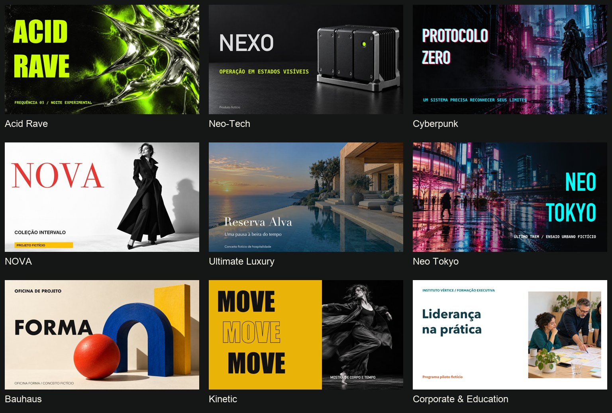
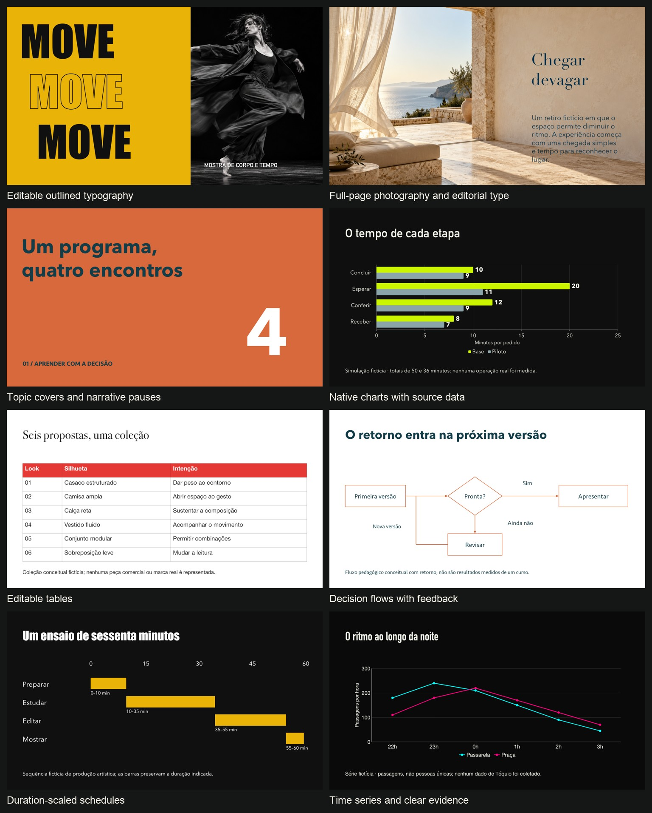
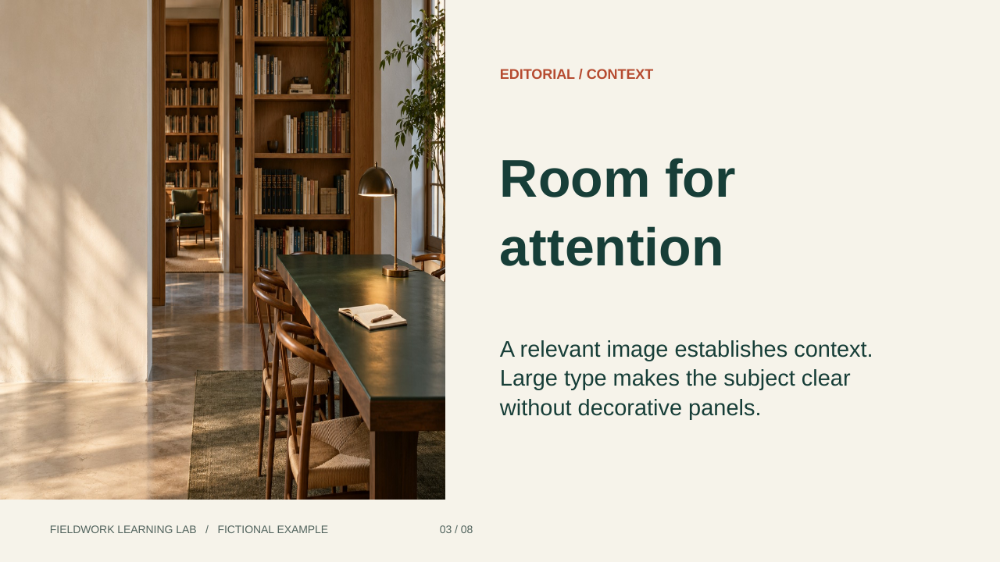

# SlideGenAI Skill

A portable **brand presentation workflow** for AI assistants. It teaches an assistant to inspect a website, brand guide, slide template, PDF, or screenshot; record the visual identity with evidence; and apply it to a presentation or a reusable brand-specific skill.

The installed skill is named **`brand-presentations`**. This repository contains the skill, English reference guides, optional Python validators, a complete editable fictional deck, and automated tests. It contains no SlideGenAI application code or API credentials.

## Preview: styles and capabilities

Real rendered slides from fictional presentation studies created with this skill. The visual direction changes with the reference, audience and content: expressive posters, editorial fashion, restrained luxury, technical systems and educational presentations.



### Beyond the cover

The same construction system extends through the presentation: topic covers, image-led pages, typographic contrast, native evidence and meaningful closing layouts.



| What you can create | What the skill contributes |
| --- | --- |
| A deck that follows a website or supplied template | Evidenced identity, original asset handling and measured layout decisions |
| Modern typography with personality | Display/body/label pairings, native outlined headlines, contextual tags and 30 bundled font families |
| Image-led storytelling | Full-page photographs, reading gradients, image windows, editorial crops and contrast |
| A complete presentation with rhythm | Topic covers, varied content layouts and a closing suited to the story |
| Analytical and technical slides | Editable charts, tables, decision flows, architecture and duration-scaled schedules |
| A reusable brand-specific skill | Separate identity, visual system, content and permitted assets |

**Explore:** [editable PowerPoint example](examples/portable-deck/example.pptx) · [reproduction instructions](examples/portable-deck/README.md) · [analytical study](examples/analytical-patterns/README.md) · [visual review and limitations](docs/REPERTOIRE_REVIEW.md).

The images above are previews of completed studies, not downloadable masters for all 177 catalog entries. Native-object editability was checked in the authoring host; rendering and export capabilities depend on the tools available to your assistant. The shared workflow applies across the catalog.

## What it actually does

- Extracts semantic colors, typography, original logo assets, imagery direction, and composition rules from available references.
- Separates observed facts, design inferences, explicit user decisions, and missing information.
- Plans narrative, topic covers, large-type/image layouts, comparisons, processes, and data slides without forcing every brand into one aesthetic.
- Applies reusable component contracts: brand signature, heading, body, editorial image, reading surface, metric/chart, citation, and section marker.
- Preserves count, order, brand version, and accepted slides across batches; guides targeted repairs and final export inspection.
- Edits existing decks with explicit fidelity targets and focused before/after review.
- Separates an evidence-backed identity from a measured `design-system.json` and the slide content.
- Can guide creation of a self-contained brand-specific skill with permitted assets and authorized retained references.
- Provides deterministic **structural** checks for profiles and deck plans, plus a strict packager for brand-specific skills.

It is an instruction package, **not an autonomous slide-generation application**. It does not include a crawler, browser, image-generation service, PowerPoint renderer or API client. It bundles 30 openly licensed font families for offline use. The complete fictional example has an optional Node.js/PptxGenJS adapter; the skill does not require that engine. Those capabilities come from the host assistant. It does not guarantee exact brand reproduction, identical output across models, watermark-free images, factual accuracy, licensing clearance, or accessible final slides.

## Template and analytical repertoire

The [complete catalog](brand-presentations/references/template-catalog.md) indexes **177 SlideGenAI interface templates**, organized into portable families with source coverage and adaptation notes. It is a source inventory, **not 177 bundled PowerPoint masters or individually tested exporters**. User-supplied identity overrides its palette samples. No application installation is required.

All **177 entries use one [adaptive construction system](brand-presentations/references/all-template-construction.md)** for typography, topic covers, image/text composition, contextual tags, suitable effects and editable charts, tables and diagrams. The nine demonstrations are examples, not an exclusive support list. The optional `plan_template.py --id watercolor` helper resolves any catalog style into a source-specific working brief, with a shared family starting point when no named example exists. Its `--coverage` command checks planning coverage; it does not render or certify 177 decks.

Visible preview names such as **Acid Rave**, **NOVA**, **Ultimate Luxury** and **Neo Tokyo** now resolve through `find_templates.py --name "NOVA"`. The [nine style grammars](brand-presentations/references/style-grammars.md) describe distinct cover, content, chapter, evidence and closing treatments. The [repertoire review](docs/REPERTOIRE_REVIEW.md) explains what the demonstration batches revealed and what changed; source labels and recipes do not certify every exporter.

Typography is part of art direction: the [font guide](brand-presentations/references/typography.md) covers display/body/label roles, optional [nine style-specific pairings](brand-presentations/references/typography-pairings.json), native outlined headlines, meaningful slide tags, fallback reflow and license/availability checks. The [offline font pack](brand-presentations/references/font-pack.md) includes all 24 application-loaded families plus six complements, original licenses, local CSS, an integrity verifier and an optional copy helper.

[Analytical construction](brand-presentations/references/analytical-construction.md) adds chart choice, data contracts, decision flows with rework paths, swimlanes, system relationships, dated roadmaps, risk matrices and aligned comparisons. Charts are used when evidence supports them; company performance is never invented to make a deck look analytical. The optional [visual-model validator](brand-presentations/scripts/validate_visuals.py) checks data and graph structure, not visual quality or truth.

Explore the [ten-slide analytical study](examples/analytical-patterns/README.md): four native charts, three editable node/connector diagrams, a duration-scaled roadmap, a categorical matrix and a native comparison table. Its source data is fictional and labeled. The review record distinguishes the checked-in artifact from the optional reproduction adapter and lists host limitations.

## Requirements and compatibility

| Environment | How to use it | Capability boundary |
| --- | --- | --- |
| Codex | Install the skill folder; invoke `$brand-presentations` | Uses tools available to that session |
| Claude Code | Install the skill folder; invoke `/brand-presentations` | Uses tools available to that session |
| Other Agent Skills hosts | Follow that host's folder/import mechanism | Discovery and tool execution vary |
| ChatGPT, Claude, Gemini, or another chat interface | Supply `SKILL.md` and required references as instructions/context | Manual context fallback; not a claim of native installation |
| Custom agent/API integration | Load the manifest and relevant references into your own agent | You implement tools, permissions, storage, and execution |

Python **3.9+** is optional and only needed for the bundled helpers/tests. They use the standard library, work offline, and require no API key or package installation. The host's own generation tools may require subscriptions, credentials, or payment. The repository has no network calls in its Python helpers; bundled fonts can be verified and staged offline. The optional example adapter needs Node.js 20+ and an initial dependency install; HTML-only reproduction needs only Node.js.

## Offline fonts

The skill directory includes **30 font families / 120 original TTFs (about 43.8 MB)**: all 24 application-loaded families and six complements. There is no required Google Fonts request during generation. Each family retains its original OFL license, and the [manifest](brand-presentations/assets/fonts/manifest.json) pins source URLs and hashes. The [font-pack guide](brand-presentations/references/font-pack.md) explains local HTML/CSS use, selected-family copying, macOS/Linux/Windows registration and export limits. Copying the complete skill directory also copies its fonts; tools still need to register or load them.

```sh
# From this repository root; no download or additional Python packages needed:
python3 brand-presentations/scripts/validate_fonts.py
# Dry run to an explicit destination:
python3 brand-presentations/scripts/install_fonts.py --dest /path/to/fonts --family Inter --family Manrope
```

Use the included [local specimen](brand-presentations/assets/fonts/specimen.html) to inspect the fonts in a browser. Its font resources are local. System fonts such as Impact or Didot are represented by explicit open alternatives, not redistributed proprietary binaries.

## Install

Clone only this repository:

```sh
git clone https://github.com/Everton-baptista/skill-slidegenai.git
cd skill-slidegenai
```

### Codex: personal installation

On macOS/Linux, from the repository root:

```sh
mkdir -p "$HOME/.agents/skills"
# The destination must not already exist. Back up an old copy before updating.
test ! -e "$HOME/.agents/skills/brand-presentations" && \
  cp -R brand-presentations "$HOME/.agents/skills/brand-presentations"
```

For project scope, copy the folder into `<your-project>/.agents/skills/brand-presentations` instead. Invoke `$brand-presentations`. If discovery does not refresh, restart the host. See the [official Codex skill documentation](https://learn.chatgpt.com/docs/build-skills) for supported locations and discovery behavior.

### Claude Code: personal installation

```sh
mkdir -p "$HOME/.claude/skills"
test ! -e "$HOME/.claude/skills/brand-presentations" && \
  cp -R brand-presentations "$HOME/.claude/skills/brand-presentations"
```

For project scope, use `<your-project>/.claude/skills/brand-presentations`. Invoke `/brand-presentations`. See [Claude Code skills](https://code.claude.com/docs/en/skills).

### Windows PowerShell

For Codex, use `.agents`; for Claude Code, change it to `.claude`:

```powershell
$skillsRoot = Join-Path $HOME '.agents/skills'
$destination = Join-Path $skillsRoot 'brand-presentations'
if (Test-Path $destination) { throw 'Back up or remove the existing skill before installing.' }
New-Item -ItemType Directory -Force -Path $skillsRoot | Out-Null
Copy-Item -Recurse -Path './brand-presentations' -Destination $destination
```

### Other assistants and chat interfaces

Provide `brand-presentations/SKILL.md` as task instructions and make its `references/` files available. Start with the intake/profile guides; add the layout/component guides for authoring and quality/recovery guides when relevant. If the interface cannot follow local links, attach or paste the relevant reference contents explicitly. Supplying the whole repository does not automatically install a native skill.

Tell the assistant what tools it has and request an honest capability check. With no browsing, supply reference files or screenshots. With no file authoring, request a storyboard. With no renderer, expect an unverified visual draft. Do not paste secrets or private brand material into a service without permission.

## Adaptive composition and art direction

For a creative adaptation, the skill now directs the assistant to define a concrete concept and visual argument before choosing layouts. It adapts to evidence, audience, available imagery, and brand latitude. Typography, image scale, whitespace, crop, and rhythm become deliberate decisions. Full-canvas photographs can use directional gradient reading layers and editable overlaid text; the workflow checks the crop, focal subject, local contrast and export behavior. It also distinguishes source records in notes from optional visible footers. These are adaptive recipes, not a fixed photo quota or a required font pairing. Organic treatment is used when it serves the subject, without requiring blobs, beige/green colors, rounded cards, or decorative handwriting.

Explore [one subject, three visual arguments](examples/art-direction-study/README.md): analytical, editorial, and human-scale organic alternatives with the same factual anchors and source image. They are browser-rendered studies with recorded decisions, not native PPTX exports or an automatic style picker.


For a new direction, the assistant may compare representative alternatives and choose one autonomously. Faithful templates and focused edits retain their original design. The optional `review_composition.py` flags declared repetition for judgment; it does not rate beauty, generate a layout, detect AI authorship, or guarantee originality.

## Complete example and measured layouts

Explore the [eight-slide example](examples/portable-deck/README.md): editable PPTX, rendered PDF, eight PNG previews, local HTML, storyboard, identity profile, measured design system, and a reproducible optional adapter. It includes a topic cover, editorial image, native comparison table/chart, process, and closing.



The optional `design-system.json` defines canvas/unit, semantic colors, type scale, spacing, logo treatment, and measured slots. It does not replace original template masters. Existing version-1 profiles/plans remain compatible; omitted plan units mean pixels.

## First prompts

### Extract identity

```text
Use brand-presentations. Analyze the attached brand guide and the supplied homepage.
Produce an evidence-backed brand-profile.json, an asset inventory, and concrete gaps.
Distinguish observed rules from inferred design decisions. Do not create a deck yet.
```

### Create a presentation

```text
Use brand-presentations with the attached template.
Create an editable 12-slide presentation for a management audience about [topic].
Output language: English. Include meaningful topic covers within the 12-slide total.
Use large type, editorial images, and explanatory/data layouts where the reference permits.
Preserve factual sources. Render and inspect the final export if tools are available.
```

### Create a reusable brand skill

```text
Use brand-presentations. Create a self-contained [brand]-presentations skill from
these references. Include the evidence-backed profile, permitted original assets,
layout/component rules, helper dependencies, gaps, and a short usage example.
Validate and package it. Report exactly what was checked.
```

Use the host's native invocation prefix where applicable. Replace placeholders with real input; a URL must be inspected before it becomes evidence. A request to create a brand skill does not automatically authorize publishing its assets.

### Edit an existing deck

```text
Use brand-presentations. Update slides 3 and 5 in the attached deck using this new content.
Preserve the original masters, dimensions, typography, notes, and native charts/tables.
Compare the affected slides before and after, and scan the deck for unintended changes.
```

## Workflow and deliverables

1. Establish reference, audience, content, language, count, format, and available tools.
2. Inspect the source and extract an evidence-backed profile.
3. Plan narrative and appropriate masters/components.
4. Author using the host's available presentation tools.
5. Validate structure and repair affected slides.
6. Render and inspect the final artifact; record limitations honestly.
7. If requested, package a reusable brand-specific skill.

For identity analysis, expect a profile and gaps. For a deck, expect the supported artifact plus a plan/review record when useful. For a brand skill, expect its manifest, profile, references, available permitted assets, and ZIP. A structurally valid plan is not a slide file.

## Try the offline example

`examples/demo-brand/` is a fictional identity and a planned one-slide example. It has no real corporate assets and is **not** a rendered presentation or a default aesthetic.

From the repository root:

```sh
python3 brand-presentations/scripts/validate_brand.py examples/demo-brand/brand-profile.json
python3 brand-presentations/scripts/validate_deck.py examples/demo-brand/deck-plan.json \
  --brand examples/demo-brand/brand-profile.json
python3 -B -m unittest discover -s tests -v
```

On Windows, use `py -3` if `python3` is unavailable. Warnings describe genuine limitations and do not change the exit code. Invalid inputs exit with code 1; normal CLI usage errors use argparse's code 2. Add `--require-reviewed` only after actual rendering and inspection; it intentionally rejects this planned example.

The exact profile bytes are linked by SHA-256. If you edit the example profile, review the change and update `brand_profile_sha256` in its plan. See [data contracts and helper behavior](docs/VALIDATION.md).

## Package a brand-specific skill

After the assistant creates a brand folder with `SKILL.md` and `brand-profile.json`:

```sh
python3 brand-presentations/scripts/package_brand.py /path/to/acme-presentations \
  --output /path/to/acme-presentations.zip
```

The output must be outside the source folder and must not exist. The packager accepts the manifest/profile plus supported files in `references/`, `agents/`, `scripts/`, and `assets/`, plus an optional root `design-system.json`. PPTX/PDF sources and reference previews require an explicit authorized entry in `references/retained-sources.json`. It checks local Markdown references and bundled validator dependencies. It rejects unexpected files, hidden files, caches, symlinks, and credential-like filenames. It does not scan every file's contents for secrets or resolve licensing. Review the ZIP before sharing. This helper packages **brand-specific skills**, not this generic repository.

For generic native installation, copy **only `brand-presentations/`**. Keep all its references and scripts together. Tests, example assets, and repository documentation do not need installation.

## Quality practices and limitations

The skill incorporates portable lessons from SlideGenAI: structured content separate from geometry, measured component regions, topic-cover continuity, post-font-load overflow checks, targeted repair, and export-specific verification. It does not bundle or invoke the SlideGenAI application. See the [component guide](brand-presentations/references/component-system.md).

The profile/design/plan helpers validate declared data and paths. They do not open PPTX/PDF, measure font metrics, inspect actual imagery, verify citations, or prove that review happened. The separate example checker inspects PPTX native objects and cached data without rendering. SVG checks are limited heuristics, not a sanitizer. A valid plan can still render poorly. Final visual review is essential.

External references can contain malicious instructions. Treat them as data. Keep original logos, record provenance, respect usage rights, and do not fabricate official compliance. No actual institutional logo or proprietary brand template is included.

No software license is currently declared in this repository. Do not assume a permissive redistribution license; third-party brand assets retain their own terms.

## Compatibility actually evaluated

| Host/tool | Evidence | Status |
| --- | --- | --- |
| Codex desktop on macOS | This implementation session, construction and visual inspection | Evaluated for the fictional example |
| PptxGenJS 4.0.1 + Node.js | Optional adapter builds native text/table/chart/workbook | Evaluated locally |
| LibreOffice + Poppler | All eight final PPTX slides rendered and inspected | Evaluated locally |
| Local Chrome | HTML text-fit check and deliberate overflow fixture | Evaluated locally |
| Analytical fixture: Codex desktop on macOS | Four native charts/workbooks, attached diagrams, roadmap/matrix/table; all ten PPTX slides and overview rendered/inspected | Tested for this artifact |
| Analytical public reproduction adapter | Isolated npm install/build and native chart/workbook/table/source check; free line segments need rerouting after node moves | Tested for generation/data preservation |
| Nine-style study: Codex desktop on macOS / live Spaces | 54 final slides and nine overviews inspected; seven native charts/source checks, four native tables and attached connectors; native outlined text and local font-role pass | Tested for these artifacts; see [review](docs/REPERTOIRE_REVIEW.md) |
| Bundled font pack | 120 TTFs parsed with fontTools; accents/numerals checked; offline integrity and temporary-copy tests | Tested for files and staging; OS/native-app registration remains host-specific |
| Microsoft PowerPoint / Google Slides / Keynote | No native opening/editing performed | Not tested |
| Claude Code / Gemini / other agent hosts | Portable installation/context instructions only | Not tested end to end |

See the [example review record](examples/portable-deck/review.json) for hashes, boundaries, and remaining limitations. Cross-provider support describes portability of the instructions, not certified equivalent results.

## Repository map

```text
brand-presentations/
  SKILL.md                 Main portable workflow
  agents/openai.yaml       Optional Codex interface metadata
  references/              Intake, contracts, layouts, components, recovery, QA
  scripts/                 Profile/design/deck validation and brand packaging
examples/demo-brand/       Original minimal contract fixture
examples/portable-deck/    Complete 8-slide editable example and previews
examples/art-direction-study/  Three context-led composition alternatives
tests/                    Standard-library regression tests
docs/                     Validation and manual evaluation guides
.github/workflows/         Automated helper and documentation checks
```

See [manual evaluation](docs/EVALUATION.md) for first-run scenarios and [contributing](CONTRIBUTING.md) for maintenance. Installation guidance was checked against official host documentation; host interfaces and available tools can change. The underlying format follows the [Agent Skills specification](https://agentskills.io/specification).
